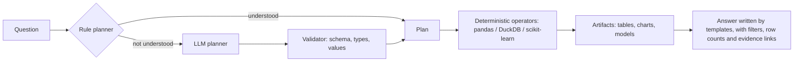

# Neural Analyst

An open-source AI data analyst. Ask a question about your data in plain language and get an
answer you can check: a language model turns the question into a plan, the plan is validated
against your dataset, and deterministic code computes every number. Each answer states the
filters it applied, the rows it matched, and links the tables behind it.

It also trains and scores models the way a careful data scientist would: leakage checks,
time-ordered evaluation, a naive baseline to beat, a decision cut-off tuned on training folds,
calibration, error by segment, and drift checks when a saved model scores a new file.

## Try it in two commands

From `ai-data-analyst/backend`, after a one-time setup (Python 3.11+, Node 20.9+:
`python -m venv .venv` then `.\.venv\Scripts\python.exe -m pip install -r requirements.txt`).
`serve` installs the frontend packages and builds the frontend on first run:

```powershell
.\.venv\Scripts\python.exe -m demo check     # load demo data, ask every demo question, verify every number
.\.venv\Scripts\python.exe -m demo serve     # start backend + frontend on the demo data
```

Then open http://localhost:3002/app/datasets. The walkthrough, talking points and preflight
checklist are in [docs/DEMO.md](docs/DEMO.md). Set `OPENAI_API_KEY` in `ai-data-analyst/backend/.env`
to enable the language-model planner; common questions are answered without it.

## What it does

- **Talk to your data**: totals, counts, averages, rates ("return rate by category"), ratios
  ("margin % by category"), shares, trends, and period comparisons with filters in plain language,
  including fiscal and retail (4-4-5) calendars, multi-sheet workbooks and files too large for memory.
- **Explain changes**: "why did sales drop in Q3?" compares the two periods by every suitable
  dimension and leads with where the change is concentrated.
- **Train**: "predict churned" trains and compares models with leakage screening, a time-ordered
  split, a baseline, ROC/PR AUC, a tuned cut-off for rare outcomes, calibration and the weakest segment.
- **Score**: "score this file with my churn model" applies a saved model to every row, checks each
  input for drift against the training data, and reports realised accuracy when the outcome is known.
- **Safe by design**: SQL sandboxing for uploaded data, per-user model registries and data,
  connection policies for external databases, and no number ever comes from the language model.

## How it works



| Layer | Where |
| --- | --- |
| Planning (rules, LLM, validation) | `ai-data-analyst/backend/app/planning/`, `app/api/routes/chat.py` |
| Operators that compute every number | `ai-data-analyst/backend/app/compute/operators/` |
| ML training, evaluation, drift, scoring | `ai-data-analyst/backend/app/ml/` |
| Web app (Next.js) | `ai-data-analyst/frontend/` |
| Demo data, script and checker | `ai-data-analyst/backend/demo/` |

Tech: FastAPI, SQLAlchemy, pandas, DuckDB, scikit-learn, LiteLLM (OpenAI by default), Next.js 16,
Plotly. Backend tests: `cd ai-data-analyst/backend && .\.venv\Scripts\python.exe -m pytest -q`.

## Talk to Your Data in detail

After a dataset is processed, **Talk to your data** offers questions based on its column types and profile. Each supported calculation opens a saved evidence table in the chat when one is available. For example, ask `average Net sales by Branch` on a file with those columns. The [companion skill](.agents/skills/neural-analyst/SKILL.md) can ask the same question and inspect the same evidence from Codex or Claude Code.

In one conversation, try `Show the monthly trend for Net sales using Invoice date for West only`, then `Now only Q1 2026`, then `What about East?`. Use your dataset’s actual column names and values. Each filtered answer shows the applied conditions and the number of matching rows. To change one part of the selection, use `remove Branch filter` or `all dates`. Use `clear all filters` to select all rows.

Dates use UTC. For a month-based fiscal calendar, try `sum Net sales in Q1 FY2026 where (Branch = West or Channel = Online)`. The chat asks for the starting month and whether a single FY label names the starting or ending year. A label such as `FY2025-26` specifies both years. Follow-ups can use `what about Q2`, `FYTD`, or `from FY2025 Q3 through FY2026 Q1`.

For a week-based calendar, try `sum Net sales in 4-4-5 P12 FY2023 where Branch = West`, then `what about week 53?`. Chat remembers the pattern and year-end convention for this dataset conversation. Choose the January preset or specify the anchor month, ending weekday, nearest or last weekday rule, FY label and which period receives the extra week. The supported patterns are 4-4-5, 4-5-4 and 5-4-4. Use `sum Net sales by retail period using Invoice date` for a breakdown. The `NRF` shorthand uses the published, non-restated 4-5-4 calendar. [NRF calendar](https://nrf.com/resources/4-5-4-calendar)

AND binds more tightly than OR. Parentheses group alternatives, and each matching row counts once. If a value, date column or follow-up is ambiguous, the chat asks for clarification. Use `cancel clarification` to return to the last completed analysis.

For large CSV, TSV, Parquet, flat JSON, XLSX and legacy XLS uploads, chat scans batches and uses temporary disk storage for aggregations. Upload the original binary `.xls` file directly. In Talk to Your Data, open **Worksheets** to select one tab or combine several. You can also ask `sum Amount across sheets "North" and "South"`. The first sheet is the default. Each tab’s first row supplies its headers. Selected tabs are stacked by column name, with blanks for absent columns. Group by the source worksheet field shown in the answer to compare tabs. Follow-ups retain the selection and filters. Excel formulas use their saved results. Counts, supported totals, grouped measures, medians, trends, numeric summaries and Pearson correlations cover every matching row. For operators that use a sample, the answer identifies the operator, sample size and matching population.

## Local Dev (Windows)

Prereqs:

- Python 3.11+
- Node 20.9+ (see `.nvmrc`)

### 1) Backend (FastAPI)

```powershell
cd ai-data-analyst\backend
Copy-Item .env.example .env  # optional (local defaults work without it)
$env:DATABASE_URL="sqlite+aiosqlite:///./dev.db"
.\.venv\Scripts\python.exe -m pip install -r requirements.txt
.\.venv\Scripts\python.exe -m uvicorn app.main:app --reload --port 8000
```

API docs: `http://localhost:8000/docs`

### 2) Frontend (Next.js)

```powershell
cd ai-data-analyst\frontend
npm ci
$env:NEXT_PUBLIC_API_URL="http://localhost:8000/api/v1"
npm run dev
```

App UI: `http://localhost:3000`

### Optional: One-command scripts

- `scripts/setup_analyst.ps1` (installs deps)
- `scripts/dev_analyst.ps1` (starts backend + frontend)

### Optional: Docker (one command self-host)

If you have Docker Desktop running:

```powershell
cd neural-analyst
docker compose up --build
```

- The backend runs Alembic migrations on startup (idempotent).
- UI: `http://localhost:3000`
- API docs: `http://localhost:8000/docs`

To run background jobs out-of-process (Celery worker + Redis), use:

```powershell
cd neural-analyst
docker compose -f docker-compose.yml -f docker-compose.celery.yml up --build
```

Convenience:
- `scripts/self_host.ps1` (PowerShell) supports `-Celery`, `-Minio`, and `-Detach`.

Object storage (optional):
- Set `OBJECT_STORE_BACKEND=s3` + `OBJECT_STORE_S3_BUCKET=...` to store uploads/artifacts in S3-compatible storage (recommended for multi-instance deployments).
- For local S3-compatible testing, use MinIO:
  - `docker compose -f docker-compose.yml -f docker-compose.minio.yml up --build`
  - (Celery + MinIO) `docker compose -f docker-compose.yml -f docker-compose.celery.yml -f docker-compose.minio.yml up --build`

## Docs

- `docs/DEMO.md`: interview demo walkthrough, talking points and preflight check.
- `docs/PROJECT_MAP.md`: folder map.
- `docs/ARCHITECTURE.md`: request flow for both apps.
- `docs/INDUSTRY_GRADE_AUDIT.md`: severity-ranked gaps + fixes/backlog.
- `docs/GITHUB_WORKFLOW.md`: how to commit/push/PR safely (with explanations).
- `docs/ROADMAP.md`: build sequence aligned to `spec_review/*`.
- `docs/SETUP.md`: setup runbook (Windows + macOS).
- `docs/DEPLOY_SAAS.md`: Cloudflare Pages + Render free-tier SaaS deployment.
- `docs/LEVELS_AND_SEQUENCE.md`: "low/medium/expert/core" capability ladder + sequential build rule.
- `spec_review/TALK_TO_YOUR_DATA_MASTER_SPEC.md`: spec pack entry point (product + engineering + security).
